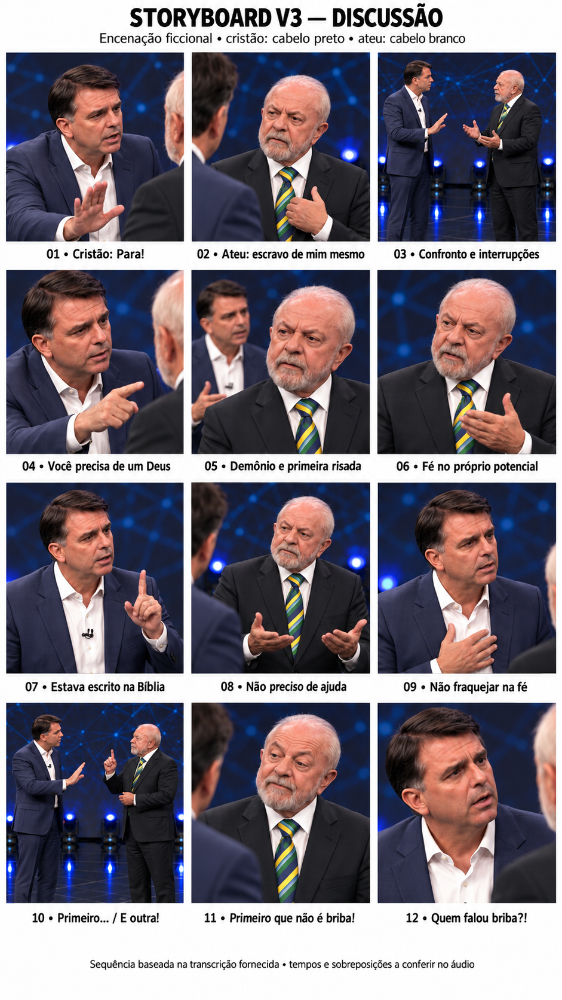

# Debate — discussão encenada

## Storyboard V3: cristão × ateu

- [Abrir o storyboard visual](storyboard/storyboard-v3.png)
- [Ler a direção dos 12 momentos](storyboard/STORYBOARD-V3.md)
- [Ouvir ou baixar o MP3 original](audio/discussao-original.mp3)
- [Abrir a prévia da prancha com áudio](previas/storyboard-v3-com-audio.mp4)
- [Ler a transcrição fornecida pelo usuário](audio/TRANSCRICAO.md)
- [Consultar os dados técnicos do áudio](audio/ANALISE.md)

**O personagem de cabelo preto começa a discussão e interpreta o cristão. O personagem de cabelo branco interpreta o ateu.** A correspondência combina a indicação do usuário de quem começa com a primeira fala da transcrição, “Para!”, atribuída ao cristão. Os números Pessoa 1/Pessoa 2 da transcrição não representam ordem de entrada.

A V3 organiza as interrupções iniciais, a defesa da autonomia, os argumentos religiosos, as risadas e o encerramento com “briba”. O palco e os figurinos vêm da referência visual; a nova discussão é uma encenação ficcional.

O MP3 original está preservado. A prévia de aproximadamente 69,30 segundos exibe a prancha inteira com o áudio completo. É uma peça de revisão, sem animação ou sincronização labial. A transcrição foi fornecida pelo usuário; tempos exatos, sobreposições e alinhamento palavra a palavra ainda não foram verificados.

**Estado:** storyboard para revisão, antes da produção das cenas. A publicação pública do áudio e da prévia foi autorizada expressamente pelo usuário.

Histórico: [V1](storyboard/STORYBOARD.md) · [V2](storyboard/STORYBOARD-V2.md).
