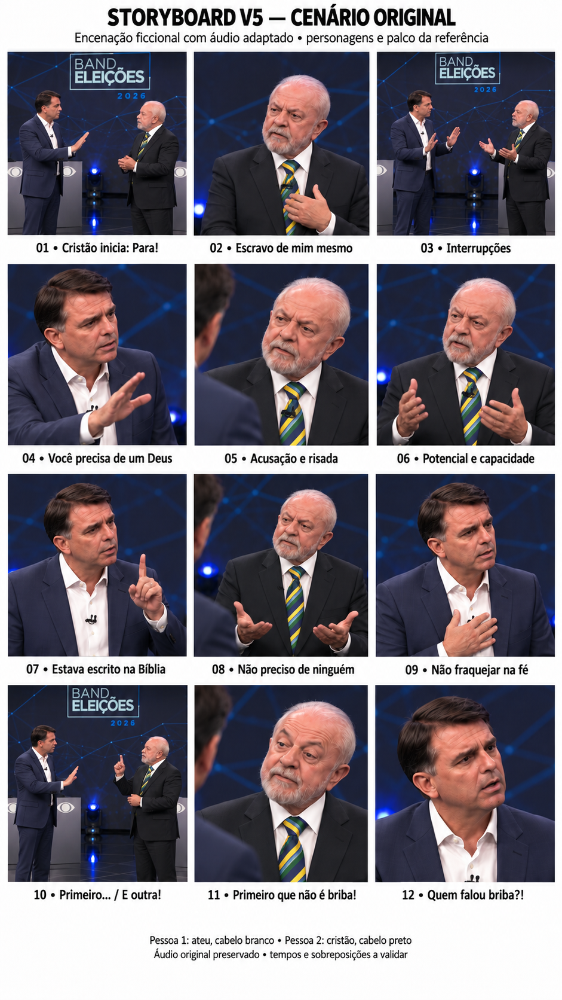

# Discussão — storyboard V5

**Cenário e personagens originais preservados.** A V5 mantém o palco televisivo e os dois homens de terno do vídeo de referência. A mudança para uma calçada e roupas casuais da V4 foi descartada por orientação do usuário.

- [Abrir a prancha V5](storyboard/storyboard-v5.png)
- [Ler o storyboard completo](storyboard/STORYBOARD-V5.md)
- [Abrir a prévia da prancha com áudio](previas/storyboard-v5-com-audio.mp4)
- [Ouvir o MP3 original fornecido](audio/discussao-original.mp3)
- [Ler a transcrição fornecida pelo usuário](audio/TRANSCRICAO.md)

**Pessoa 2 — cristão:** cabelo preto, terno azul-marinho e camisa branca aberta no colarinho; inicia com “Para!”.

**Pessoa 1 — ateu:** cabelo e barba brancos, terno escuro, camisa branca e gravata verde e amarela.

As melhorias são de atuação, escuta, progressão emocional, enquadramentos, biomecânica e continuidade. A narrativa segue a transcrição fornecida, preservando o áudio da discussão. É uma adaptação ficcional; a trilha não é apresentada como áudio autêntico do debate de referência.

**Estado:** storyboard para revisão, antes da produção das cenas. A prévia contém a prancha estática com áudio, sem animação ou sincronização labial. Os tempos exatos e as sobreposições precisam ser conferidos no MP3. O arquivo original de áudio permanece intacto; sua publicação e a das prévias foram autorizadas pelo usuário. As imagens geradas orientam o enquadramento e devem ser conferidas contra a identidade dos participantes no vídeo.

Histórico: [V1](storyboard/STORYBOARD.md) · [V2](storyboard/STORYBOARD-V2.md) · [V3](storyboard/STORYBOARD-V3.md) · [V4 descartada](storyboard/STORYBOARD-V4.md).
