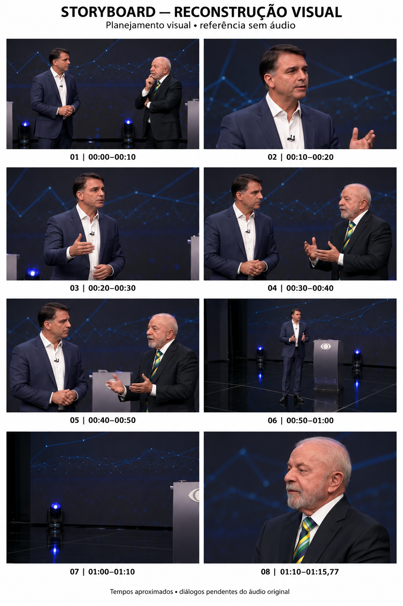

# Debate — storyboard visual

Planejamento de reconstrução audiovisual em estilo **live-action naturalista**.

## Material disponível

- Referência: vídeo vertical de 75,77 segundos, 720 × 1280, 30 fps, H.264.
- O arquivo recebido contém apenas vídeo, sem faixa de áudio.
- A imagem acima foi gerada para planejamento; não é uma extração dos quadros originais.
- Os oito quadros são representativos de blocos aproximados. Não reproduzem todos os cortes.
- A referência é vertical; os quadros ilustrativos da prancha são horizontais. A composição final deverá ser adaptada para 9:16.
- O storyboard aguarda revisão do usuário. A produção individual das cenas ainda não começou.

Veja o [roteiro do storyboard](storyboard/STORYBOARD.md).

## Próximas etapas

1. Revisar o storyboard.
2. Receber a versão com áudio ou a trilha correspondente e definir sua preservação.
3. Conferir falas, falantes, tempos e cortes.
4. Após aprovação, desenvolver uma cena por vez com atuação, câmera, prompt para Google Flow e continuidade.

A duração-alvo de dez segundos por bloco é uma referência de planejamento, sujeita às falas e aos limites reais da ferramenta de geração.
