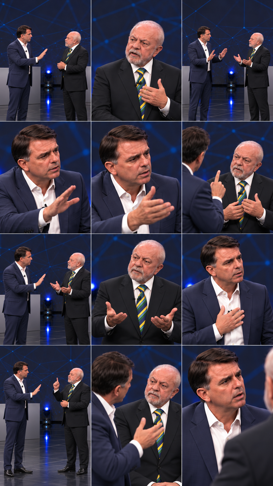

# Storyboard V7 — imagens limpas, cena por cena

**Pessoas e palco originais mantidos. Todas as imagens novas estão sem textos, legendas, logotipos, marcas ou contadores.** O detalhamento fica no roteiro e no PDF, fora das imagens.

- [Abrir o PDF detalhado — 12 cenas](storyboard/v7/STORYBOARD-V7.pdf)
- [Ler o roteiro e o cálculo por cena](storyboard/v7/STORYBOARD-V7.md)
- [Abrir as 12 imagens e os prompts individuais](storyboard/v7/cenas)
- [Baixar os cálculos em CSV](storyboard/v7/PLANO-CENAS.csv)
- [Abrir a prévia limpa com áudio](previas/storyboard-v7-limpo-com-audio.mp4)
- [Conferir o diálogo literal](audio/DIALOGO-CANONICO.txt)
- [Ouvir o áudio original](audio/discussao-original.mp3)

**Pessoa 2 — cristão:** cabelo preto, terno azul-marinho, camisa branca; inicia com “Para!”. **Pessoa 1 — ateu:** cabelo e barba brancos, terno escuro, camisa branca e gravata verde e amarela.

O diálogo continua completo, na ordem enviada pelo usuário: 169 palavras, 22 intervenções e duas marcações de risadas. A única divisão interna de uma fala fica entre as duas frases da intervenção 19, de uma cena para a seguinte, sem adicionar pausa.

## Plano para Google Flow

A [documentação oficial do Flow](https://support.google.com/flow/answer/16352836?hl=en) oferece 4/6/8 segundos nos modos Veo 3.1 com frames e 8 segundos no modo Ingredients/References compatível. Este projeto foi dividido em 12 cenas com teto de 8 segundos. As gerações sugeridas somam 84 segundos no plano com Frames, ou 96 segundos se todos os clipes forem de 8 segundos com References. Na edição, aproveitar apenas o tempo visual necessário ao áudio original.

**Os tempos por cena são estimativas**, calculadas pela distribuição das 169 palavras, com reservas hipotéticas para pausas e risadas, ajustadas ao total de aproximadamente 69,26 segundos decodificados. Não são marcações já conferidas no MP3. O áudio não foi recortado nos intervalos estimados. Antes de gerar e sincronizar, marcar os turnos reais e ajustar os limites sem cortar palavras nem acelerar vozes.

A prévia mostra a prancha estática com áudio, sem animação ou lip-sync validado. A adaptação é ficcional; sua identificação fica nesta documentação, não sobre as imagens. O MP3 original permanece intacto. A produção das cenas individuais aguarda revisão do storyboard.

Histórico: [V6 — diálogo canônico](storyboard/STORYBOARD-V6.md). As imagens antigas permanecem como histórico; usar a V7 para os recursos visuais limpos.
