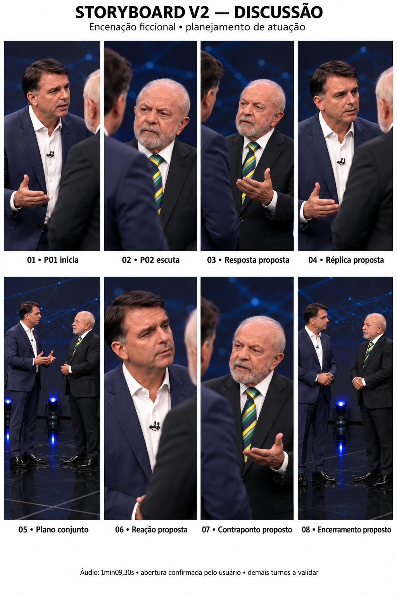

# Storyboard V2 — discussão

> Histórico: substituído pelo [storyboard V3](STORYBOARD-V3.md), com a transcrição fornecida e a autorização de publicação do áudio. As pendências abaixo descrevem o estado da V2 no momento de sua criação.

**Proposta de encenação ficcional para revisão.** A aparência dos participantes e o palco vêm da referência visual. O MP3 fornecido será a trilha da discussão. Não se trata de registro autêntico dessas pessoas proferindo o áudio.

## O que foi confirmado

- O usuário definiu que a discussão começa com o personagem de cabelo preto, identificado como **P01**.
- **P02** é o participante de cabelo e barba brancos.
- O arquivo de áudio possui aproximadamente 69,30 segundos; a referência visual tem 75,77 segundos. A diferença é de aproximadamente 6,46 segundos.
- O áudio original foi mantido em arquivo separado, sem edição.

## Limite da análise

Foi feita verificação técnica do arquivo e detecção de pausas por nível de sinal. Não foi possível executar reconhecimento de fala porque o download do modelo foi bloqueado pela rede. Não há transcrição nem diarização validada. A abertura é uma informação do usuário, não uma conclusão de análise vocal. As respostas e reações abaixo são propostas de direção. Os quadros não têm tempos individuais justamente para não atribuir falas sem confirmação.

## Direção de continuidade

P01: cabelo curto preto/escuro, terno azul-marinho, camisa branca aberta no colarinho, microfone na camisa. P02: cabelo curto branco, barba branca, terno escuro, camisa branca, gravata verde e amarela. Manter P01 à esquerda e P02 à direita nos planos conjuntos, cerca de 1,2 m de distância, sem atravessar o eixo entre eles. Adaptar cada plano ao formato vertical 9:16.

Palco escuro, linhas azuis no fundo, luzes azuis próximas ao chão e iluminação frontal plausível. Evitar grafismos eleitorais e contadores que conflitem com a nova discussão. Pele e roupas com textura real; equilíbrio corporal e movimentos das mãos anatomicamente plausíveis.

## Oito quadros de atuação

| Quadro | Plano e composição | Ação e expressão propostas | Relação com a fala | Continuidade |
|---|---|---|---|---|
| 01 — P01 inicia | Plano médio vertical de P01; P02 no limite do quadro. | P01 encara P02, inclina discretamente o tronco e usa uma mão aberta próxima à cintura. Tensão contida. | A primeira intervenção é de P01, conforme o usuário. P02 escuta. O fim dessa fala ainda precisa ser marcado. | P01 permanece à esquerda; mão retorna gradualmente à posição de repouso. |
| 02 — P02 escuta | Contraplano sobre o ombro de P01, foco em P02. | P02 mantém a boca fechada, leve tensão nas sobrancelhas e mudança sutil do olhar. | Reação proposta durante a abertura de P01. Sem inventar uma fala de P02. | Manter direção do olhar para P01 e postura do plano conjunto. |
| 03 — Resposta proposta | Plano médio de P02. | Na resposta, P02 abre uma mão à altura do peito; gesto único, sem agitação contínua. | Usar apenas quando o turno de P02 for identificado no áudio. | P01 permanece em escuta, fora do foco. |
| 04 — Réplica proposta | Plano médio próximo de P01. | P01 reage com olhar firme e gesto curto, sem avançar sobre o outro. | Entrada condicionada à confirmação da próxima fala de P01. | Não saltar de mãos abaixadas para erguidas entre planos. |
| 05 — Plano conjunto | Os dois em 9:16, com profundidade suficiente para não comprimir seus corpos. | Mostrar a relação espacial e o contraste entre quem fala e quem ouve. | Definir quem fala somente após verificar o turno correspondente. Sobreposição só se existir no áudio. | Preservar eixo, distância e iluminação. |
| 06 — Reação proposta | Close naturalista de P01. | Boca fechada, sobrancelha levemente elevada, pequena inspiração ou ajuste postural. | Usar como reação durante uma fala confirmada de P02, sem ocultar toda a articulação necessária ao lip-sync. | Olhar consistente para a direita do quadro. |
| 07 — Contraponto proposto | Plano médio próximo de P02. | Pequeno gesto de palma para cima; expressão compatível com a fala depois de conferida. | Posição e duração dependem do áudio; não se presume argumento ou crença. | Evitar repetição mecânica do gesto do quadro 03. |
| 08 — Encerramento proposto | Plano conjunto ou reação final. | Recolher gestos de modo orgânico; expressão final a definir pelo conteúdo real. | Preservar a última fala, pausa ou risada existente; não forçar silêncio enquanto alguém ainda fala. | Não completar artificialmente os 75,77 s da referência visual. |

## Montagem com o áudio

1. Trabalhar na duração do MP3, sem acelerar ou desacelerar vozes para caber no vídeo antigo.
2. Preservar a cópia original; para MP4, o áudio da prévia é recodificado em AAC e não é idêntico em bytes ao MP3.
3. Marcar os turnos e as palavras antes de definir os cortes e a articulação da boca. Pausas detectadas não equivalem a trocas de falante.
4. Evitar os longos recortes de palco vazio da V1 como cobertura automática: propor reações de escuta no lugar, sujeitas à revisão.
5. Usar dez segundos apenas como duração-alvo, nunca como motivo para interromper frases.
6. Produzir clipes individuais somente após a revisão do storyboard.

## Prévia preparada localmente

A prévia local em MP4 mantém a prancha V2 inteira na tela com o áudio completo. Serve para ouvir o material enquanto se revisa o planejamento. Não representa edição final, atuação em movimento nem sincronização labial. O MP3 e essa prévia não foram publicados neste repositório: sua publicação pública aguarda autorização explícita do usuário.

## Pendências para fechar o storyboard

- Transcrever e validar as falas.
- Confirmar a correspondência de cada voz com P01/P02 após a abertura.
- Determinar tempos de entrada/saída e sobreposições.
- Ajustar a ordem dos quadros propostos ao que efetivamente acontece no áudio.
- Revisar a prancha e aprovar antes da produção das cenas.
