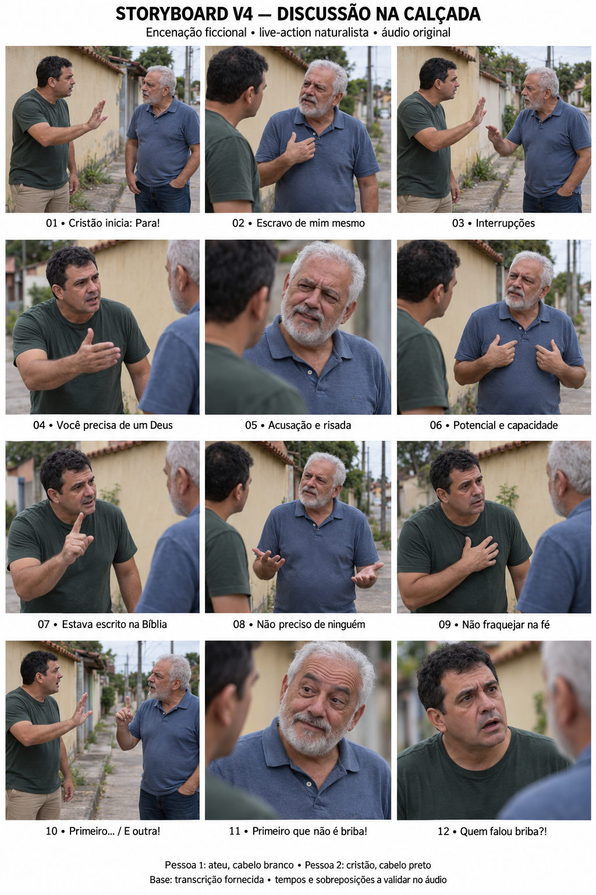

# Storyboard V4 — discussão na calçada

**Encenação ficcional • live-action naturalista • áudio original como referência principal.**

## Mudança de direção

A discussão sai do palco televisivo e passa para uma calçada de bairro brasileiro, sob luz natural difusa. Dois homens comuns, com rostos ficcionais próprios e roupas casuais, discutem enquanto uma terceira pessoa próxima registra a situação. Os rostos desta versão substituem os participantes reconhecíveis da referência anterior; sua identidade deve permanecer estável ao longo da V4.

A intensidade vem da interpretação vocal original e das reações. Não acrescentar gritos, frases, risadas, música ou efeitos cômicos. A aparência documental é a direção da encenação; a apresentação do projeto deve continuar identificando-a como ficcional.

## Personagens e vozes

| Atributo | Pessoa 1 — Ateu | Pessoa 2 — Cristão |
|---|---|---|
| Identidade visual proposta | Brasileiro, cerca de 60 anos, cabelo curto branco, barba branca curta, pele morena clara, proporções naturais. | Brasileiro, cerca de 45 anos, cabelo preto curto, sem barba, pele morena, proporções naturais. |
| Roupa fixa | Polo azul desbotada, jeans escuro, tênis escuros simples. | Camiseta verde-escura desbotada, calça bege de algodão, sapatos casuais marrons gastos. |
| Posição de referência | Direita do plano conjunto; olha para a esquerda. | Esquerda do plano conjunto; olha para a direita. |
| Impulso dramático | Defender autonomia, concluir suas frases e resistir às interrupções. | Interromper, contestar e afirmar sua convicção religiosa com urgência. |
| Corpo e expressão | Contato visual firme, mandíbula tensionada nos trechos enfáticos, pequenas negativas de cabeça, gesto em direção ao próprio peito e mãos abertas na recusa. | Testa franzida, olhar intenso, abertura de boca compatível com as exclamações, gestos maiores motivados pelas intervenções e pequenos movimentos de cabeça. |
| Durante a escuta | Olhar de incredulidade, ajuste de peso e respiração; não congelar. | Impaciência contida, piscadas, pequeno ajuste dos ombros ou da cabeça; não congelar. |

**Quem começa:** o cristão de cabelo preto abre com “Para!”. Os números Pessoa 1 e Pessoa 2 seguem a transcrição, não a ordem de entrada. A associação entre voz e personagem não pode mudar. As descrições vocais do pedido orientam a leitura visual, mas não autorizam sintetizar, alterar o volume ou reinterpretar a gravação original.

## Ambiente e câmera

Calçada com concreto gasto, muro baixo de reboco ocre claro, casa simples de telhado cerâmico ao fundo, vegetação discreta e poste afastado. Nada de cenário de debate, púlpito, terno, gravata, marca de emissora ou contador eleitoral. Manter os objetos de fundo nas mesmas posições entre planos.

Luz difusa de céu encoberto, sombra suave e exposição estável. Pele com poros e pequenas imperfeições, roupas com peso e dobras plausíveis. Lentes de aparência natural, aproximadamente 35–50 mm equivalentes; evitar grande-angular muito próxima dos rostos. Profundidade de campo que conserve o contexto.

Composição final **vertical 9:16**. A prancha contém enquadramentos ilustrativos, que deverão ser ajustados a 9:16 nos recursos de cena. Câmera na altura dos olhos, oscilação manual discreta e pequenos ajustes para acompanhar quem disputa a palavra. Não criar tremor artificial constante. Manter o eixo entre os homens, separados por aproximadamente 1,2 m, sem contato físico.

## Progressão e quadros

As fases são dramáticas; não são intervalos temporais medidos. Os 12 quadros representam momentos importantes dos aproximadamente 69,30 s de áudio, não 12 clipes de dez segundos.

| Quadro / fase | Âncora verbal e ação proposta | Câmera | Continuidade e escuta |
|---|---|---|---|
| **01 — Confronto inicial** | Cristão: “Para!”. Ateu tenta “Eu não sou...”. Cristão abre uma palma num gesto curto de contenção. A tensão já existe no primeiro quadro. | Começar com plano conjunto próximo para estabelecer os participantes e o espaço. | Cristão à esquerda e ateu à direita. Ateu prepara a resposta com pequena inspiração e mudança de olhar, sem antecipar articulação. |
| **02 — Defesa da autonomia** | Ateu: “Eu sou escravo de mim mesmo!”. Leva uma mão à região do peito, sustenta o olhar e tenta completar a ideia. | Plano médio do ateu, incluindo mão e tronco. | Cristão permanece ativo no fundo ou fora de foco, com impaciência sutil. A mão do ateu não salta para outra posição no corte seguinte. |
| **03 — Insistência e interrupções** | Preservar as repetições de “conversa fiada”, “escravo de mim mesmo” e “Eu não preciso de senhor.”. Alternar contenção e insistência sem movimentos mecânicos. | Sustentar plano conjunto ou pequeno reenquadramento, evitando um corte por frase. | Registrar se os gestos estão subindo, parados ou retornando. Só mostrar as duas bocas articulando ao mesmo tempo se as duas vozes realmente se sobrepuserem. |
| **04 — Escalada: Deus** | Cristão: “Você precisa é de um Deus na sua vida!”. Ateu: “Não preciso.”. Cristão amplia o gesto com palma aberta, sem invadir fisicamente o outro. | Plano médio do cristão e resposta do ateu no mesmo plano, quando possível. | Ateu reage com mandíbula e olhar antes de sua resposta. Não alterar a intensidade gravada para aumentar o drama. |
| **05 — Acusação e primeira risada** | “Porque você está possuído pelo demônio!”; risadas; continuação sobre o pensamento dos ateus. Cristão mantém convicção; ateu reage com incredulidade. | Reação próxima do ateu, com referência espacial do ombro do cristão. Retornar a quem fala quando necessário. | A risada fica onde está no original. Não criar plateia nem atribuir automaticamente toda risada a um dos personagens. Não antecipar o riso antes da frase. |
| **06 — Potencial e capacidade** | Ateu: “Eu tenho fé no meu potencial! Na minha capacidade!”. Mão aberta perto do peito, sobrancelhas contraídas e respiração entre impulsos conforme a gravação. | Plano médio próximo do ateu, com os olhos e o gesto legíveis. | Cristão escuta com tensão de testa e mudança pequena de postura. A ênfase em “eu”, “potencial” e “capacidade” deve acompanhar o áudio existente. |
| **07 — Disputa: Bíblia e capacidade** | Manter a alternância: cristão “Estava escrito!...”; ateu “Na minha capacidade de vencer!”; cristão “Está escrito nisso! Eu fui preparado...”. | Preferir plano conjunto ou médio com ambos para que possíveis falas simultâneas possam ser vistas. | O quadro ilustrativo enfatiza o cristão; a tomada deve cobrir também as intervenções do ateu. A existência e duração de sobreposição ainda precisam de marcação no MP3. |
| **08 — Recusa de ajuda** | Ateu repete “Eu não preciso da ajuda de ninguém!”. Abre discretamente as mãos, muda o peso e insiste; a segunda repetição varia organicamente. | Plano médio, sem esconder mãos ou cortar articulações de modo incômodo. | Não reiniciar a mesma animação na repetição. Cristão acompanha com olhar fixo e respiração, sem articular uma fala que ainda não entrou. |
| **09 — Convicção e final dos tempos** | Cristão: “Eu fui preparado para não fraquejar em minha fé!” e continuação sobre a Bíblia e o final dos tempos. Uma mão aproxima-se do peito, depois relaxa. | Plano médio do cristão; reação do ateu só quando não prejudicar a leitura da intervenção. | Volume, respirações e pausas vêm do áudio. Intensidade corporal proporcional, sem expressão de surpresa permanente. |
| **10 — Tentativa de tomar a palavra** | Ateu: “Primeiro...”. Cristão: “E outra! Antes do mundo acabar, os judeus vão se converter ao cristianismo!”. Ateu inicia pequeno gesto; cristão retoma com gesto maior. | Plano conjunto próximo que preserve ambos durante a disputa. | Seguir a ordem e eventuais sobreposições reais. Não acrescentar imagens religiosas nem apresentar a afirmação do personagem como fato externo à discussão. |
| **11 — Virada cômica** | Ateu: “Primeiro que não é briba!”. Pequena elevação de sobrancelha e alteração de expressão; depois, risadas conforme a gravação. | Close motivado no ateu, sem aproximação chamativa ou zoom de piada. | Não corrigir “briba” para “Bíblia”. A transcrição não permite afirmar quem usou essa pronúncia antes; conferir o áudio sem inventar fala anterior. |
| **12 — Pergunta final** | Cristão: “Quem falou briba?!”. Reação de surpresa, leve virada de cabeça e abertura labial ligada à fala. | Close naturalista do cristão; sustentar a reação apenas pelo tempo que existir na gravação. | Preservar o tempo cômico original. Sem risada adicional, efeito sonoro, frase de resposta ou pausa fabricada. |

## Biomecânica e atuação em todas as cenas

- Gestos começam com ombro e braço em coordenação, desaceleram e retornam de modo plausível. Não manter braços levantados por toda a discussão.
- A transferência de peso precede inclinações maiores do tronco. Pés permanecem apoiados; não deslizam ou mudam de lugar entre quadros.
- Piscar e mudar o olhar organicamente, sem repetição sincronizada entre os dois. A direção do olhar permanece coerente com a posição do interlocutor.
- Respiração acompanha pausas e esforços presentes na trilha; não inventar ofegância constante. Ombros, pescoço e mandíbula ajustam-se com a fala.
- Enquanto ouve, cada participante reage com olhar, tensão facial, respiração ou postura. Movimento labial de fala só ocorre quando sua voz entra. Reações não precisam virar gestos grandes.
- Não dirigir “intensidade” como grito permanente, olhos sempre arregalados ou careta. A dimensão expressiva do cristão deve permanecer humana; o ateu não se torna passivo.

## Áudio definitivo e sincronização

O [MP3 original](../audio/discussao-original.mp3) permanece intacto como cópia de referência. A [transcrição integral](../audio/TRANSCRICAO.md) foi fornecida pelo usuário e não foi alinhada automaticamente ao áudio. A leitura do conteúdo desta V4 vem desse texto; não se declara diarização ou análise auditiva integral que não foram realizadas.

Antes da animação labial, marcar início e fim de cada voz, fonemas, pausas, risadas e trechos simultâneos. **Pessoa 1 = ateu; Pessoa 2 = cristão.** Não mudar falas de personagem nem reformular expressões. A boca de cada personagem articula sua fala audível; durante sobreposição real, ambos articulam. Risos e respirações visíveis seguem sua atribuição quando confirmada.

Não gerar novas vozes. Se o Google Flow não aceitar sincronização com o áudio enviado, gerar os recursos visuais após aprovação e fazer o alinhamento em etapa externa compatível, mantendo a trilha original como base. Não prometer precisão de lip-sync apenas com instruções de prompt. A exportação AAC pode preservar o conteúdo audível, mas não é idêntica em bytes ao MP3 original.

Não acrescentar som ambiente nesta revisão, para conservar o conteúdo do áudio fornecido. O ambiente visual não exige inventar sons de rua.

## Divisão em clipes e ficha de continuidade

Usar cerca de dez segundos como alvo de geração, respeitando limites do modelo e evitando cortar frases só para completar duração. A referência visual antiga de 75,77 s não determina o novo comprimento: seguir os aproximadamente 69,30 s do áudio. Os limites definitivos dos clipes dependem da marcação dos turnos.

Para cada limite de clipe, registrar: tempo exato do áudio; último fonema ou pausa; posição dos pés e distribuição do peso; ângulo do tronco e cabeça; direção do olhar; mão direita e esquerda; fase do gesto; estado da respiração; expressão; posição e altura da câmera; enquadramento; luz; objetos do fundo. O primeiro quadro seguinte deve continuar esse estado sem reiniciar expressão ou gesto. Usar o frame final como referência quando o recurso realmente estiver disponível.

## Prévia e aprovação

A [prévia V4 com áudio](../previas/storyboard-v4-com-audio.mp4) mostra a prancha estática acompanhada pelo MP3 completo recodificado para AAC. Ela permite revisar ambiente, personagens e progressão; não é uma cena animada, nem prova de sincronização labial.

Após revisar e aprovar a V4, preparar uma cena por vez com quadro de referência, falas e tempos confirmados, atuação, câmera, prompt compatível com Google Flow, continuidade e verificação. Não iniciar produção individual antes dessa revisão.
