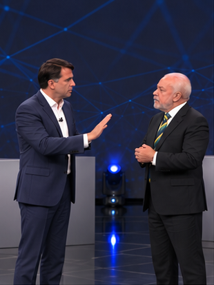

# Cena 01 — Abertura e primeira afirmação

**Encaixe estimado:** 15 palavras; 6.05 s de diálogo/pausas; gerar 8 s no modo com frame inicial, ou 8 s no modo References compatível. Folga teórica no modo frames: 1.95 s. Intervalo de planejamento: 0.00–6.05 s — não validado no áudio.

## Diálogo literal

[Pessoa 2 — Cristão]: Para!
[Pessoa 1 — Ateu]: Eu não sou...
[Pessoa 2 — Cristão]: Para com essa conversa fiada!
[Pessoa 1 — Ateu]: Eu sou escravo de mim mesmo!

## Atuação

Cristão abre com palma de contenção; ateu tenta responder e leva a mão à região do peito.

## Câmera

Plano conjunto vertical próximo, preservando ambos nas trocas.

## Continuidade

Concluir com a mão do ateu próxima ao peito; cristão pronto para retomar. O primeiro quadro da cena seguinte continua esse estado; não reiniciar gesto ou expressão. Conferir frame final, boca, mão direita/esquerda, pés, respiração, olhar, posição da câmera e ponto do áudio.

## Prompt visual para Google Flow

Live-action naturalista fotorrealista, personagens e palco da referência preservados. Pessoa 2: cristão de cabelo preto, terno azul-marinho, camisa branca aberta no colarinho, à esquerda. Pessoa 1: ateu de cabelo e barba brancos, terno escuro, camisa branca e gravata verde e amarela, à direita. Painel escuro com linhas azuis, piso preto refletivo, púlpitos cinza e luzes azuis. Nenhuma palavra, legenda, escrita, marca, logotipo, símbolo de emissora, contador ou letreiro em nenhuma superfície. Não trocar rostos, roupas, proporções ou cenário. Pele real e gestos anatomicamente plausíveis; reações de escuta com olhar, respiração, piscadas e pequenas mudanças de peso. Proporção 9:16, iluminação original de estúdio, câmera documental discreta. Não criar novas vozes nem reformular o áudio. O diálogo abaixo é referência literal de atuação para sincronização ao MP3 externo; não é autorização para sintetizar novamente a trilha. Articulação final somente após alinhamento por voz e tempo. Se não houver importação/sincronização nativa, entregar visuais sem nova fala e montar externamente com a trilha original.

Ação específica: Cristão abre com palma de contenção; ateu tenta responder e leva a mão à região do peito. Câmera: Plano conjunto vertical próximo, preservando ambos nas trocas. Continuidade: Concluir com a mão do ateu próxima ao peito; cristão pronto para retomar. Duração de geração: 8 segundos no modo frames, ou 8 segundos no modo References. Ajustar o uso na montagem ao tempo real do MP3, sem acelerar o áudio.

Diálogo de referência literal, mantido fora da imagem:

[Pessoa 2 — Cristão]: Para!
[Pessoa 1 — Ateu]: Eu não sou...
[Pessoa 2 — Cristão]: Para com essa conversa fiada!
[Pessoa 1 — Ateu]: Eu sou escravo de mim mesmo!

## Verificação

Confirmar a duração real antes de gerar; a estimativa não valida lip-sync. Conferir fidelidade literal, papéis, risadas, sobreposições reais, identidade, mãos e ausência completa de texto/logotipo na imagem. Se o trecho exceder o clipe, dividir em limite natural e preservar continuidade, sem modificar o áudio.
