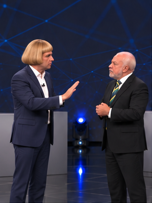
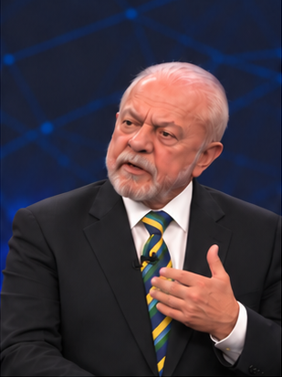
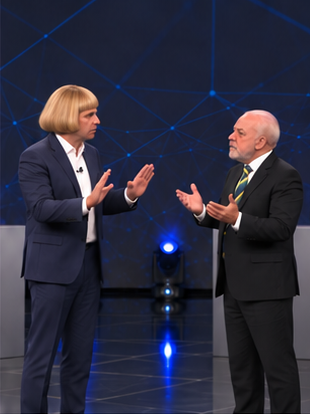
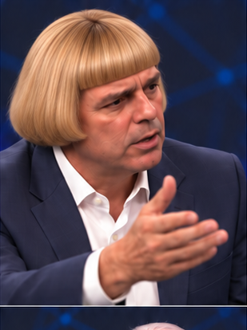
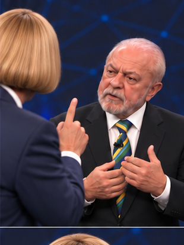
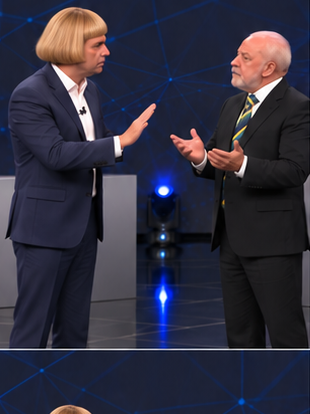
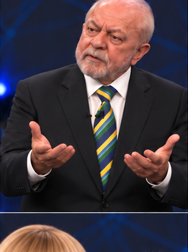
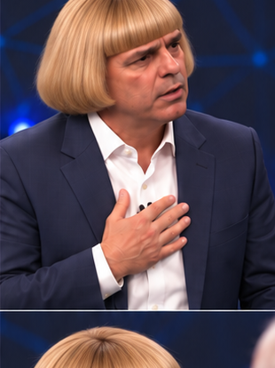
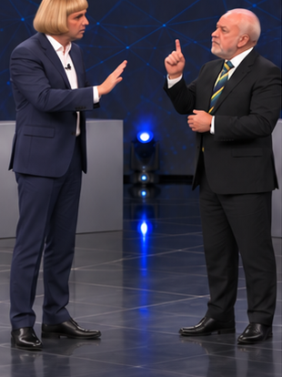
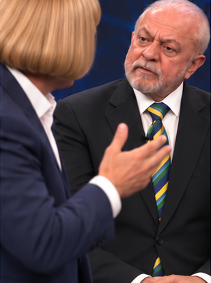

# Storyboard V8 — imagens limpas e cenas para Google Flow

**Pessoas e palco originais preservados. Imagens sem qualquer texto, legenda, logotipo, marca, contador ou escrita no painel/púlpitos.** O detalhamento e as falas ficam fora das imagens.

- [PDF completo por cena](STORYBOARD-V8.pdf)
- [Prancha visual limpa](prancha-limpa.png)
- [Cálculos em CSV](PLANO-CENAS.csv)
- [Plano em JSON](PLANO-CENAS.json)
- [Diálogo canônico](../../audio/DIALOGO-CANONICO.txt)
- [Áudio original](../../audio/discussao-original.mp3)

## Capacidade do Flow e estratégia

A documentação oficial do [Google Flow](https://support.google.com/flow/answer/16352836?hl=en) informa que os modos Veo 3.1 de texto e frames oferecem 4, 6 ou 8 segundos, conforme o recurso. No modo Ingredients/References compatível, os vídeos são de 8 segundos. O mesmo documento lista 10 segundos para Gemini Omni Flash 1.1; isso não significa que todo modelo aceite 10 segundos. Este plano usa Veo 3.1 com teto de 8 segundos. Conferir o modelo e o modo selecionados na conta antes de gastar créditos.

O plano tem **12 cenas**, com cerca de **69,26 s de áudio decodificado** (69,30 s no contêiner MP3). No fluxo com frame inicial, as durações sugeridas somam **84 s de geração** antes da montagem. No fluxo Ingredients/References que exige 8 s por clipe, gerar **12 × 8 = 96 s**, e aproveitar somente as durações visuais necessárias. Não alongar ou acelerar as vozes para preencher os clipes. O excedente é imagem de apoio para aparar, não áudio adicional.

## Como o encaixe foi estimado — não são timestamps medidos

A transcrição tem **169 palavras**, 22 intervenções e duas marcações de risadas. Como ainda não há alinhamento das palavras ao MP3, o cálculo reserva, por hipótese, 2,0 s à primeira risada, 2,5 s à risada da plateia e 0,15 s a cada intervenção. O restante é distribuído por palavras:

`(69,26 − 2,0 − 2,5 − 22 × 0,15) ÷ 169 = 0,363669 s por palavra`

Isso corresponde a aproximadamente **165 palavras por minuto nos blocos lexicais estimados**, ou 146 palavras por minuto contando o arquivo todo. Não é uma medição da velocidade de cada voz. O modelo soma aproximadamente 0,15 s por início de intervenção e mantém as risadas como eventos separados. Cada cena foi dimensionada para caber no limite escolhido sob essa hipótese.

Sobreposições, palavras de comprimentos diferentes, ênfases e pausas reais podem mudar o encaixe. Por isso os intervalos abaixo são **previsões**, os campos de tempo validado estão falsos e o áudio não foi recortado nesses pontos. Antes de gerar, conferir o trecho real: se ultrapassar o limite, dividir em pausa ou limite de frase, mantendo a trilha contínua; nunca cortar palavras ou acelerar a fala. A cena 09 tem a menor folga e pode precisar de 6 s após conferência. A risada final tem duração hipotética; ampliar o clipe 12 se necessário.

## Quadro de encaixe

| Cena | Palavras | Diálogo + pausas estimados | Gerar com frame inicial | Gerar com References | Intervalo estimado no áudio |
|---|---:|---:|---:|---:|---|
| 01 | 15 | 6.05 s | 8 s | 8 s | 0.00–6.05 s |
| 02 | 18 | 7.00 s | 8 s | 8 s | 6.05–13.05 s |
| 03 | 16 | 6.27 s | 8 s | 8 s | 13.05–19.32 s |
| 04 | 6 | 4.33 s | 6 s | 8 s | 19.32–23.65 s |
| 05 | 19 | 7.06 s | 8 s | 8 s | 23.65–30.71 s |
| 06 | 19 | 7.21 s | 8 s | 8 s | 30.71–37.92 s |
| 07 | 17 | 6.48 s | 8 s | 8 s | 37.92–44.40 s |
| 08 | 14 | 5.24 s | 6 s | 8 s | 44.40–49.65 s |
| 09 | 9 | 3.42 s | 4 s | 8 s | 49.65–53.07 s |
| 10 | 15 | 5.61 s | 6 s | 8 s | 53.07–58.67 s |
| 11 | 18 | 6.85 s | 8 s | 8 s | 58.67–65.52 s |
| 12 | 3 | 3.74 s | 6 s | 8 s | 65.52–69.26 s |

## Regras de identidade, áudio e imagem

Pessoa 2 — cristão: cabelo loiro em corte chanel volumoso, com franja reta, terno azul-marinho e camisa branca; inicia com “Para!”. Pessoa 1 — ateu: cabelo e barba brancos, terno escuro, camisa branca e gravata verde e amarela. Manter rostos e figurinos da referência, palco escuro, grafismos azuis sem letras, piso refletivo, luzes azuis e geometria dos púlpitos. A remoção de textos não autoriza trocar o cenário ou as pessoas.

A adaptação de áudio é ficcional; essa identificação fica na documentação, não gravada sobre as imagens. A prancha e os quadros são referências geradas; conferir identidades contra o vídeo. Manter proporção final vertical 9:16 com ajustes de composição quando necessário. Não cortar cabeças/mãos apenas para encaixar um quadro da prancha.

O áudio enviado é a fonte definitiva: não sintetizar vozes, corrigir “briba”, eliminar repetições ou substituir risadas. O MP3 permanece intacto. Os prompts orientam os visuais; não garantem importação de MP3 ou lip-sync no Flow. Se a função de áudio original não estiver disponível, gerar os visuais e alinhar a trilha numa ferramenta externa compatível. Em sobreposição real, ambos devem articular suas próprias vozes; durante escuta, reagir com olhar, respiração e postura.

A intervenção 19 foi dividida apenas na fronteira entre suas duas frases: cena 09 termina em “fé!” e cena 10 continua com “Porque”. Isso não retira nenhuma palavra nem impõe uma pausa nova. É uma continuidade do mesmo turno do cristão. As demais intervenções permanecem inteiras.

## Cena 01 — Abertura e primeira afirmação

**Estimativa:** 6.05 s; gerar 8 s com frame inicial ou 8 s com References.

[Pessoa 2 — Cristão]: Para!
[Pessoa 1 — Ateu]: Eu não sou...
[Pessoa 2 — Cristão]: Para com essa conversa fiada!
[Pessoa 1 — Ateu]: Eu sou escravo de mim mesmo!

**Atuação:** Cristão abre com palma de contenção; ateu tenta responder e leva a mão à região do peito.

**Câmera:** Plano conjunto vertical próximo, preservando ambos nas trocas.

**Continuidade:** Concluir com a mão do ateu próxima ao peito; cristão pronto para retomar.

[Detalhamento e prompt desta cena](cenas/cena-01.md)

## Cena 02 — Insistência e repetições

**Estimativa:** 7.00 s; gerar 8 s com frame inicial ou 8 s com References.

[Pessoa 2 — Cristão]: Para com essa conversa fiada sua!
[Pessoa 1 — Ateu]: Eu sou escravo de mim mesmo.
[Pessoa 2 — Cristão]: Para com essa conversa fiada sua!

**Atuação:** Preservar as duas intervenções idênticas do cristão separadas pela repetição do ateu. Variar pequenos gestos e reações de escuta.

**Câmera:** Plano conjunto com reenquadramento manual discreto.

**Continuidade:** Continuar a tensão e a posição das mãos sem reiniciar o gesto de parar.

[Detalhamento e prompt desta cena](cenas/cena-02.md)

## Cena 03 — Senhor, Deus e recusa

**Estimativa:** 6.27 s; gerar 8 s com frame inicial ou 8 s com References.

[Pessoa 1 — Ateu]: Eu não preciso de senhor.
[Pessoa 2 — Cristão]: Você precisa é de um Deus na sua vida!
[Pessoa 1 — Ateu]: Não preciso.

**Atuação:** Ateu recusa senhor; cristão responde com mão aberta; ateu faz a resposta breve sem explicação adicional.

**Câmera:** Plano médio dos dois ou plano/contraplano motivado por quem fala.

**Continuidade:** Ateu termina a recusa com olhar firme; cristão prepara a próxima intervenção.

[Detalhamento e prompt desta cena](cenas/cena-03.md)

## Cena 04 — Acusação e primeira risada

**Estimativa:** 4.33 s; gerar 6 s com frame inicial ou 8 s com References.

[Pessoa 2 — Cristão]: Porque você está possuído pelo demônio!
[Risadas]

**Atuação:** Cristão enfatiza a acusação; ateu reage com incredulidade. Não atribuir a primeira risada a um rosto sem confirmação.

**Câmera:** Plano próximo do cristão e reação do ouvinte, se houver tempo real.

**Continuidade:** Manter a risada na trilha e o cristão pronto para continuar; sem nova plateia visual.

[Detalhamento e prompt desta cena](cenas/cena-04.md)

## Cena 05 — Continuação sobre o pensamento

**Estimativa:** 7.06 s; gerar 8 s com frame inicial ou 8 s com References.

[Pessoa 2 — Cristão]: O demônio tomou conta do seu pensamento! Assim como tomou conta dos pensamentos de todos os ateus do mundo!

**Atuação:** Cristão pronuncia integralmente as duas frases. Ouvinte reage com testa, mandíbula e postura, sem congelar.

**Câmera:** Plano médio do cristão, com ombro do ateu como referência espacial.

**Continuidade:** Terminar o gesto de ênfase gradualmente; ateu prepara a resposta.

[Detalhamento e prompt desta cena](cenas/cena-05.md)

## Cena 06 — Potencial e Bíblia

**Estimativa:** 7.21 s; gerar 8 s com frame inicial ou 8 s com References.

[Pessoa 1 — Ateu]: Eu tenho fé no meu potencial! Na minha capacidade!
[Pessoa 2 — Cristão]: Estava escrito! Estava escrito na Bíblia que isso iria acontecer!

**Atuação:** Ateu enfatiza o próprio potencial; cristão entra com a repetição de “Estava escrito!”. Não fundir nem encurtar as falas.

**Câmera:** Plano conjunto ou plano/contraplano com no máximo uma troca motivada.

**Continuidade:** Cristão conclui com gesto contido; ateu mantém a intenção de completar a ideia.

[Detalhamento e prompt desta cena](cenas/cena-06.md)

## Cena 07 — Capacidade de vencer e fé

**Estimativa:** 6.48 s; gerar 8 s com frame inicial ou 8 s com References.

[Pessoa 1 — Ateu]: Na minha capacidade de vencer!
[Pessoa 2 — Cristão]: Está escrito nisso! Eu fui preparado para não fraquejar em minha fé!

**Atuação:** Ateu retoma sua frase; cristão mantém “Está escrito nisso!” e a continuação sobre a fé, exatamente.

**Câmera:** Plano conjunto para preservar disputa e possíveis sobreposições reais.

**Continuidade:** Cristão pode manter mão perto do peito; ateu prepara o próximo gesto.

[Detalhamento e prompt desta cena](cenas/cena-07.md)

## Cena 08 — Recusa de ajuda duas vezes

**Estimativa:** 5.24 s; gerar 6 s com frame inicial ou 8 s com References.

[Pessoa 1 — Ateu]: Eu não preciso da ajuda de ninguém! Eu não preciso da ajuda de ninguém!

**Atuação:** Ateu repete a frase integral duas vezes, com pequena variação corporal. Cristão reage durante a escuta.

**Câmera:** Plano médio do ateu incluindo as duas mãos, sem cortar articulações.

**Continuidade:** Recolher as mãos naturalmente; cristão volta à fala no próximo trecho.

[Detalhamento e prompt desta cena](cenas/cena-08.md)

## Cena 09 — Declaração de fé — início do mesmo turno

**Estimativa:** 3.42 s; gerar 4 s com frame inicial ou 8 s com References.

[Pessoa 2 — Cristão]: Eu fui preparado para não fraquejar em minha fé!

**Atuação:** Cristão inicia a intervenção longa com a declaração de fé. Esta é a primeira frase de uma única fala que continua na cena seguinte.

**Câmera:** Plano médio contínuo do cristão; usar o mesmo eixo e posição na continuação.

**Continuidade:** Obrigatório manter gesto, olhar e respiração em andamento. Não introduzir pausa no áudio.

[Detalhamento e prompt desta cena](cenas/cena-09.md)

## Cena 10 — Final dos tempos e tentativa de falar

**Estimativa:** 5.61 s; gerar 6 s com frame inicial ou 8 s com References.

[Pessoa 2 — Cristão]: Porque está escrito na Bíblia que, no final dos tempos, tudo isso iria acontecer!
[Pessoa 1 — Ateu]: Primeiro...

**Atuação:** Cristão continua imediatamente a mesma fala. Ateu tenta iniciar “Primeiro...”. Sem novo começo ou silêncio fabricado.

**Câmera:** Continuação do plano anterior; abrir discretamente para mostrar a tentativa do ateu.

**Continuidade:** Ateu começa pequeno gesto, a ser preservado na entrada do cristão na próxima cena.

[Detalhamento e prompt desta cena](cenas/cena-10.md)

## Cena 11 — E outra! e a correção

**Estimativa:** 6.85 s; gerar 8 s com frame inicial ou 8 s com References.

[Pessoa 2 — Cristão]: E outra! Antes do mundo acabar, os judeus vão se converter ao cristianismo!
[Pessoa 1 — Ateu]: Primeiro que não é briba!

**Atuação:** Cristão intervém com “E outra!” e conclui sua frase; ateu faz a correção exata, sem alterar “briba”.

**Câmera:** Plano conjunto próximo ou corte único para a reação do ateu, conforme o áudio real.

**Continuidade:** Não antecipar risadas antes da correção; preparar reação de surpresa do cristão.

[Detalhamento e prompt desta cena](cenas/cena-11.md)

## Cena 12 — Risadas da plateia e pergunta final

**Estimativa:** 3.74 s; gerar 6 s com frame inicial ou 8 s com References.

[Risadas da plateia]
[Pessoa 2 — Cristão]: Quem falou briba?!

**Atuação:** Preservar as risadas da plateia e a pergunta do cristão. Sem efeito cômico novo, sem resposta extra, sem substituir por risos dos personagens.

**Câmera:** Close naturalista do cristão, com referência espacial do interlocutor.

**Continuidade:** Encerrar no fim real da trilha; conservar apenas a reação que couber sem inventar tempo.

[Detalhamento e prompt desta cena](cenas/cena-12.md)

**Continuidade do cabelo — atualização autorizada:** somente o cristão passa a usar cabelo loiro dourado em corte chanel/pageboy, franja curta reta e grossa, laterais arredondadas volumosas na altura do queixo, pontas voltadas para dentro. Manter o rosto, a idade, a pele, o corpo, o terno azul-marinho e a camisa branca originais. Aplicar o mesmo cabelo nas vistas frontais, de perfil e de costas. O ateu mantém o cabelo branco curto e a barba branca. Não acrescentar bigode ou copiar o rosto/roupas das referências de cabelo.
