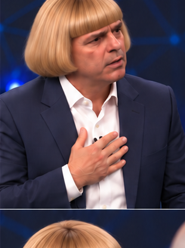

# Cena 09 — Declaração de fé — início do mesmo turno

**Encaixe estimado:** 9 palavras; 3.42 s de diálogo/pausas; gerar 4 s no modo com frame inicial, ou 8 s no modo References compatível. Folga teórica no modo frames: 0.58 s. Intervalo de planejamento: 49.65–53.07 s — não validado no áudio.

## Diálogo literal

[Pessoa 2 — Cristão]: Eu fui preparado para não fraquejar em minha fé!

## Atuação

Cristão inicia a intervenção longa com a declaração de fé. Esta é a primeira frase de uma única fala que continua na cena seguinte.

## Câmera

Plano médio contínuo do cristão; usar o mesmo eixo e posição na continuação.

## Continuidade

Obrigatório manter gesto, olhar e respiração em andamento. Não introduzir pausa no áudio. O primeiro quadro da cena seguinte continua esse estado; não reiniciar gesto ou expressão. Conferir frame final, boca, mão direita/esquerda, pés, respiração, olhar, posição da câmera e ponto do áudio.

## Prompt visual para Google Flow

Live-action naturalista fotorrealista, personagens e palco da referência preservados. Pessoa 2: cristão de cabelo loiro em corte chanel volumoso, com franja reta, terno azul-marinho, camisa branca aberta no colarinho, à esquerda. Pessoa 1: ateu de cabelo grisalho em chonmage e barba branca, terno escuro, camisa branca e gravata verde e amarela, à direita. Painel escuro com linhas azuis, piso preto refletivo, púlpitos cinza e luzes azuis. Nenhuma palavra, legenda, escrita, marca, logotipo, símbolo de emissora, contador ou letreiro em nenhuma superfície. Não trocar rostos, roupas, proporções ou cenário. Pele real e gestos anatomicamente plausíveis; reações de escuta com olhar, respiração, piscadas e pequenas mudanças de peso. Proporção 9:16, iluminação original de estúdio, câmera documental discreta. Não criar novas vozes nem reformular o áudio. O diálogo abaixo é referência literal de atuação para sincronização ao MP3 externo; não é autorização para sintetizar novamente a trilha. Articulação final somente após alinhamento por voz e tempo. Se não houver importação/sincronização nativa, entregar visuais sem nova fala e montar externamente com a trilha original.

Ação específica: Cristão inicia a intervenção longa com a declaração de fé. Esta é a primeira frase de uma única fala que continua na cena seguinte. Câmera: Plano médio contínuo do cristão; usar o mesmo eixo e posição na continuação. Continuidade: Obrigatório manter gesto, olhar e respiração em andamento. Não introduzir pausa no áudio. Duração de geração: 4 segundos no modo frames, ou 8 segundos no modo References. Ajustar o uso na montagem ao tempo real do MP3, sem acelerar o áudio.

Diálogo de referência literal, mantido fora da imagem:

[Pessoa 2 — Cristão]: Eu fui preparado para não fraquejar em minha fé!

## Verificação

Confirmar a duração real antes de gerar; a estimativa não valida lip-sync. Conferir fidelidade literal, papéis, risadas, sobreposições reais, identidade, mãos e ausência completa de texto/logotipo na imagem. Se o trecho exceder o clipe, dividir em limite natural e preservar continuidade, sem modificar o áudio.

**Continuidade do cabelo — atualização autorizada:** somente o cristão passa a usar cabelo loiro dourado em corte chanel/pageboy, franja curta reta e grossa, laterais arredondadas volumosas na altura do queixo, pontas voltadas para dentro. Manter o rosto, a idade, a pele, o corpo, o terno azul-marinho e a camisa branca originais. Aplicar o mesmo cabelo nas vistas frontais, de perfil e de costas. O ateu mantém o cabelo grisalho em chonmage e a barba branca. Não acrescentar bigode ou copiar o rosto/roupas das referências de cabelo.

**Continuidade do ateu — atualização autorizada:** penteado chonmage em todos os ângulos: topo central raspado, laterais e nuca penteadas para trás e presas em pequeno coque/tufo dobrado no alto posterior da cabeça. Manter a cor original grisalha/branca, com fios prateados; não tingir de preto. Rosto, barba branca, traços, idade, pele, terno escuro, camisa branca e gravata verde e amarela continuam como referência. Não copiar rostos ou roupas das referências de cabelo. O cristão mantém o cabelo loiro chanel com franja reta definido anteriormente.
